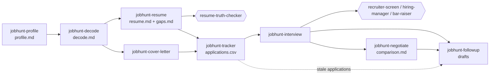

# job-hunt-skill

**Your whole job search team, from reading the posting to negotiating the offer, without a single invented line on your resume.**

 

Job hunting is a second full-time job with no training. You read postings
written in code ("wear many hats", "fast-paced"), rewrite the same resume
forty times, guess which keywords a screening system wants, freeze on "tell me
about a time you failed", and then accept the first number you are offered
because asking for more feels risky.

This pack gives Claude Code eight skills and four interviewer agents that
cover the whole loop: build a record of your real experience once, decode each
posting, tailor the resume and cover letter to it, rehearse every interview
round, compare offers on real total compensation, write the follow-up
messages, and track it all in a spreadsheet you own.

One rule runs through every part: **nothing is invented.** Skills reword and
reorder your real experience. If a posting asks for something you do not have,
you get an honest gap and a plan to close it, not a fabricated bullet. A
read-only truth-checker agent audits every tailored resume against your
profile before you see it.

It works for any field: nursing, teaching, operations, trades, law, sales,
design, engineering. Your data stays in a local `jobhunt/` folder.

## What's inside

### Skills

| Skill | What it does |
|---|---|
| [`jobhunt-profile`](skills/jobhunt-profile/SKILL.md) | A short interview that builds `jobhunt/profile.md`: roles, dates, achievements with numbers you confirm, skills with evidence, and private constraints (location, salary floor, visa). Every other skill reads it. |
| [`jobhunt-decode`](skills/jobhunt-decode/SKILL.md) | Decodes a posting: must-haves vs nice-to-haves, what the wording says about seniority and team state, red flags, the likely interview loop, your fit, and questions to ask them. |
| [`jobhunt-resume`](skills/jobhunt-resume/SKILL.md) | Tailors your resume to one posting from the profile only, then runs `ats_match.py` for keyword coverage, missing terms and over-used words. Terms you truly lack go to a gaps list. |
| [`jobhunt-cover-letter`](skills/jobhunt-cover-letter/SKILL.md) | A cover letter under 250 words tied to the employer's actual situation, with a banned-clichés list and a three-sentence version for form boxes. |
| [`jobhunt-interview`](skills/jobhunt-interview/SKILL.md) | Mock interviews with the agent panel: STAR and role-specific questions one at a time, a 20-point rubric, and a stronger rewrite of each answer that uses only facts you gave. |
| [`jobhunt-negotiate`](skills/jobhunt-negotiate/SKILL.md) | Compares offers on year-1 and 4-year total comp with `offer_compare.py`, then drafts a counter-offer email and call talking points. |
| [`jobhunt-followup`](skills/jobhunt-followup/SKILL.md) | Thank-you notes, follow-ups after silence, accepting, declining, withdrawing, and reference requests. Always drafted, never sent. |
| [`jobhunt-tracker`](skills/jobhunt-tracker/SKILL.md) | Keeps `jobhunt/applications.csv` with `tracker.py`: add, update, list, and stats (response rate, stage funnel, applications that need a follow-up). |

### Agents

| Agent | Role |
|---|---|
| [`recruiter-screen`](agents/recruiter-screen.md) | The first phone screen: background, motivation, must-have checks, logistics, salary expectations. |
| [`hiring-manager`](agents/hiring-manager.md) | Depth in the actual work, judgment on situations from the role, and motivation for this team. |
| [`bar-raiser`](agents/bar-raiser.md) | The tough round. Ladders of probes until an answer hits specifics, ownership and measurable results. |
| [`resume-truth-checker`](agents/resume-truth-checker.md) | Read-only auditor. Flags any resume or cover-letter claim that `profile.md` does not support. |

### Helper scripts

Python 3.9+, standard library only, no network access, deterministic output.

| Script | Purpose |
|---|---|
| `skills/jobhunt-resume/ats_match.py` | Keyword and phrase coverage of a resume against a posting. |
| `skills/jobhunt-negotiate/offer_compare.py` | Year-1 and multi-year total-comp table from offers in JSON. |
| `skills/jobhunt-tracker/tracker.py` | CSV application tracker with funnel and stale-application stats. |

## Install

Inside Claude Code:

```
/plugin marketplace add vivekbhange-hub/job-hunt-skill
/plugin install job-hunt-skill@job-hunt-skill
```

Manual install: copy `skills/*` into `~/.claude/skills/` and `agents/*` into
`~/.claude/agents/`.

Then make an empty folder for your search (for example `~/job-search`), open
Claude Code there, and start.

## Try it in 60 seconds

Start with the profile:

```
Set up my job search. Here is my CV: cv.pdf
```

Claude reads the CV, then asks three questions at a time about your targets,
constraints and each role, and checks every number with you ("exact, an
estimate, or a range you can defend?"). The result is `jobhunt/profile.md`.

Then paste a posting:

```
Decode this job post: <paste the posting>
```

Example output (an illustrative excerpt for a fictional ward-manager posting,
not a real company):

```
# Ward Manager at Riverside Community Hospital (decoded 2026-11-07)
Verdict: Apply with a plan for gaps - you meet 5 of 6 must-haves; the budget gap is closable.

## Signals
| Phrase                         | Likely meaning                    | Confidence | What to ask                          |
| "bring stability to the team"  | recent turnover or a leadership gap | likely   | "Why is the role open?"              |
| "flexible approach to shifts"  | regular cover of short-staffed shifts | possible | "How often does the manager cover?" |

## Fit against your profile
| Must-have              | Your evidence (from profile.md)                    | Rating  |
| Band 6+ ward experience | "Charge nurse, 28-bed surgical ward, 2021-present" | Strong  |
| Budget management       | none                                               | Gap     |

## Gaps and how to close them
- Budget management: ask your current manager to walk you through the ward's
  cost report this month, and say so honestly if asked in the interview.
```

Comparing two offers is one command. This is real output from the example
file in the repo:

```
python skills/jobhunt-negotiate/offer_compare.py skills/jobhunt-negotiate/offers.example.json
```

```
|  | Company A | Company B |
|---|---:|---:|
| Base (year 1) | USD 120,000 | USD 132,000 |
| Equity vested in year 1 | USD 20,000 | USD 0 |
| Commute cost | USD -1,728 | USD 0 |
| **Year-1 total** | **USD 169,272** | **USD 139,000** |
| **4-year total** | **USD 647,088** | **USD 580,239** |
| Commute hours / year | 168 | 0 |
```

## How it works



Everything lands in one folder you control:

```
jobhunt/
  profile.md                  your master record
  applications.csv            the tracker
  roles/<company>-<role>/     posting.md, decode.md, resume.md, ats-report.md,
                              gaps.md, cover-letter.md, interview-notes.md,
                              prep-sheet.md, drafts/
  offers/                     offers.json, comparison.md, negotiation-<company>.md
```

## Principles and limits

- **No invention.** No skill adds experience, skills, titles, dates or numbers
  you did not confirm. Estimates stay estimates. Gaps are named, with a way to
  close them.
- **Drafts only.** Nothing is emailed, submitted or posted. You send every
  message yourself.
- **Local data.** Your profile, salary floor and visa status stay in
  `jobhunt/`. The scripts make no network calls. If you work inside a git
  repository, keep `jobhunt/` out of commits.
- **Not advice.** The offer comparison is arithmetic on numbers you provide,
  not financial, tax or legal advice. Equity can be worth nothing. Hiring law
  differs by country.
- **No guarantees.** Keyword coverage is a heuristic, not a copy of any
  vendor's screening system. A strong match helps a human reader too, but no
  tool can promise an interview.
- **No web scraping.** Paste postings in; the skills do not log in to job
  boards or apply on your behalf.

## Contributing

Improvements, especially examples from fields outside tech, are welcome. See
[CONTRIBUTING.md](CONTRIBUTING.md). Run the tests with:

```
python -m unittest discover -s tests -v
```

## License

[MIT](LICENSE) © 2026 Vivek Bhange
